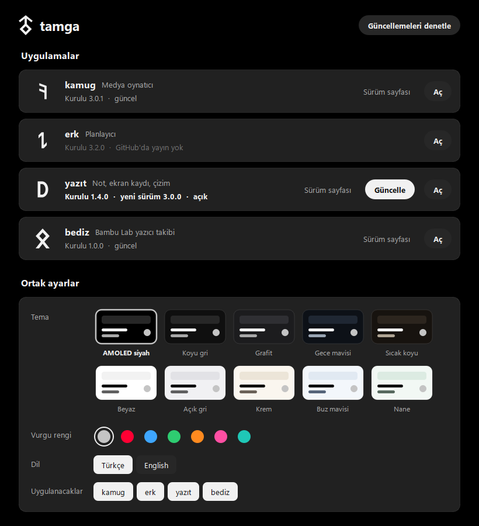
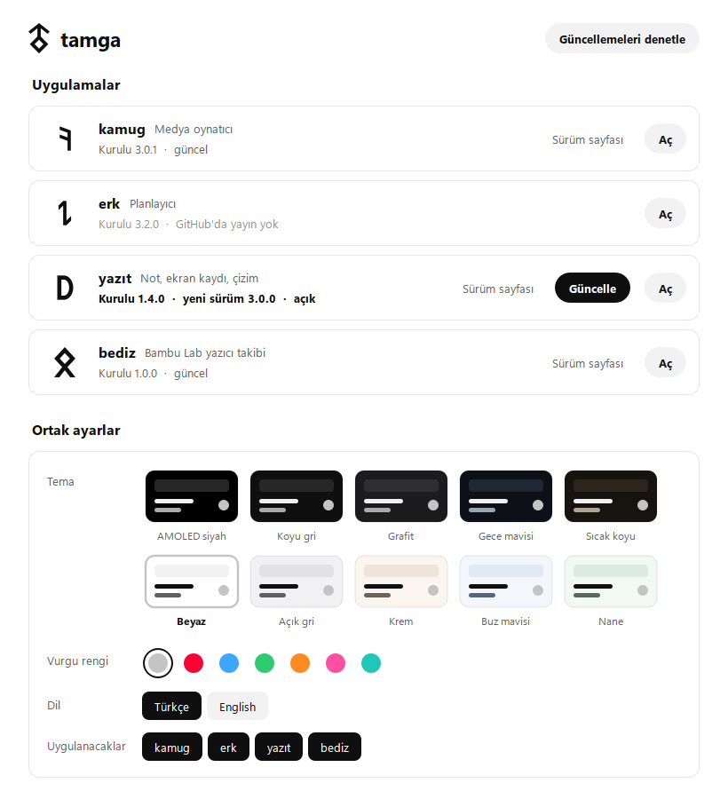

```powershell
$ProgressPreference = 'SilentlyContinue'; $a = (irm https://api.github.com/repos/yigitozsoy/tamga/releases/latest).assets | ? name -like '*setup*.exe' | select -First 1; irm $a.browser_download_url -OutFile "$env:TEMP\$($a.name)"; & "$env:TEMP\$($a.name)"
```

<sub>PowerShell'e yapıştırın: son sürümü indirip kurulumu açar. Elle indirmek için [Releases](../../releases/latest).</sub>

<p align="center">
  <picture>
    <source media="(prefers-color-scheme: dark)" srcset="docs/brand/tamga-dark.png">
    
  </picture>
</p>

<h1 align="center">tamga</h1>

<p align="center">
  Ailenin dört uygulamasını tek yerden kurmak, açmak, güncellemek ve aynı görünüme getirmek için başlatıcı.<br>
  <sub>Windows 10 / 11 (64-bit)</sub>
</p>

| | |
|---|---|
| [**kamug**](https://github.com/yigitozsoy/kamug_oynatici) | Video, müzik, görsel ve 3D modeller için medya oynatıcı |
| **erk** | Kişisel planlayıcı |
| [**yazıt**](https://github.com/yigitozsoy/yazit_tahta) | Not, çizim tahtası ve ekran kaydı |
| [**bediz**](https://github.com/yigitozsoy/bediz_takip) | Bambu Lab 3D yazıcı takibi |

## Özellikler

- **Tek tıkla kur ve güncelle.** Her uygulamanın kurulu sürümü ve GitHub'daki son sürümü yan yana; yeni sürüm varsa
  indirir ve kurar, açık uygulamayı kapatıp yeniden açar.
- **Ortak görünüm.** 10 tema, vurgu rengi ve dil bir kez seçilir, dört uygulamaya birden uygulanır; açık olanlar hemen değişir.
- **Hızlı açılış.** Kurulu uygulamaları buradan aç; hangilerinin açık olduğunu gösterir.
- **Hafif ve gizli.** Yönetici izni istemez; GitHub'dan yalnızca herkese açık sürüm bilgisini okur.

## Görseller

<p align="center">
  
  
</p>

## Lisans

[GPL-3.0](LICENSE) © Yiğit Özsoy. [PyQt6](https://www.riverbankcomputing.com/software/pyqt/) (GPL) kullanır.
